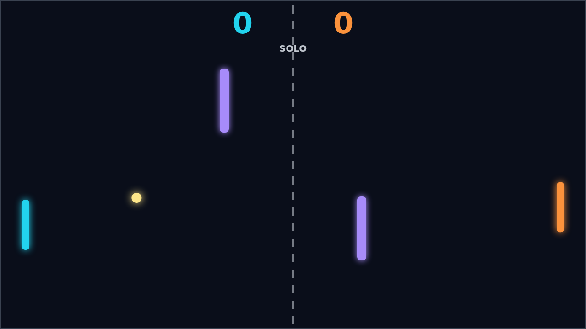
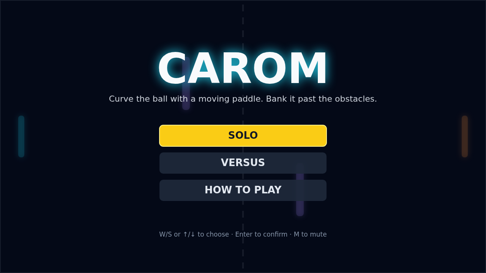
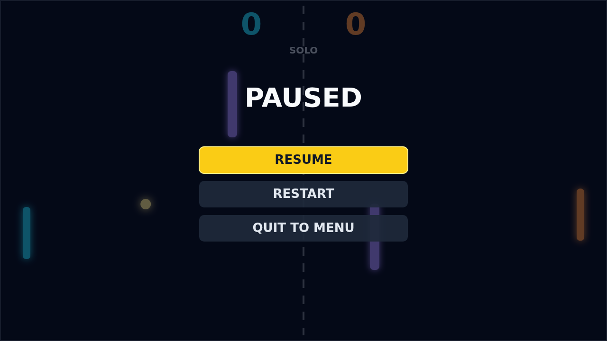

Carom is a top-down paddle duel built around one delicious idea: a moving paddle doesn't just hit the ball, it bends it. Every rally starts simply enough, the ball leaving the centre after a short hold and travelling toward the player about to receive it, but the first paddle contact changes everything. Where you meet the ball sets its angle, how fast you hit it raises the pace, and whether your paddle is rising or falling at that instant loads it with spin that keeps curving its flight long after the strike.

The field between the paddles is not empty. Two violet obstacles guard the middle, turning straight attacks into blocked shots and inviting bank shots instead: bounce off the top or bottom wall, thread a lane beside a barrier, or add enough spin that the ball arcs around it. Because spin survives wall and obstacle bounces, a shot you shape at your own paddle can still be bending as it arrives, wrong-footing a defender who read its first direction.

Matches build nicely from that opening exchange. The ball accelerates with every paddle hit, so late rallies at deuce feel frantic while the early points stay readable. Solo play pits you against an AI that tracks the incoming ball and otherwise drifts back to centre; Versus puts two players on one keyboard, W and S against the arrow keys, where a mistimed swing is a gift. First to eleven wins, but you need a lead of two, so match point is never quite safe.

What makes Carom linger is how physical the curve feels. A gentle paddle drift gives a shot a lazy bend you can aim around an obstacle; a full-speed strike whips it into a hook that kisses the wall and dives. You are always choosing between a safe return and a shaped one, and the best points end with the ball bending away from a paddle that was already in the right place a heartbeat earlier.
